<div align="center">

<a href="https://grimnej.com">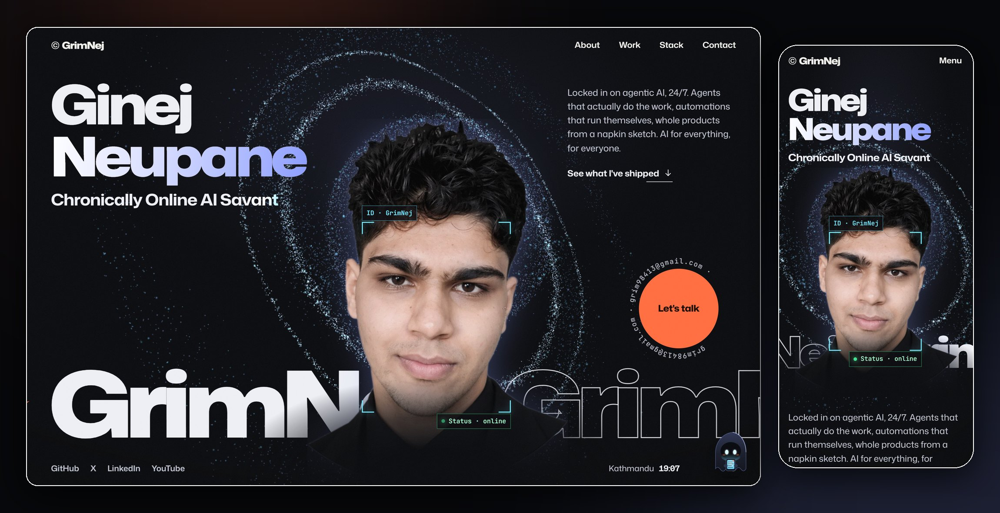</a>

# Portfolio Design Skill

**A Claude Code skill that interviews you and builds you a portfolio like [grimnej.com](https://grimnej.com).**<br />
Particle galaxy, cut-out portrait with an ASCII lens, a name that reacts to your cursor, a ghost that chats, a ball pit of your tools, and your GitHub, live. Then it tests the whole thing in a real browser and ships it.

[](https://grimnej.com)
[](#install)
[](LICENSE)


</div>

---

## The design

One page, twelve scenes, zero templates-that-look-like-templates. Everything below is from the live example at [grimnej.com](https://grimnej.com), and every bit of it is what the skill generates for you.

<div align="center">
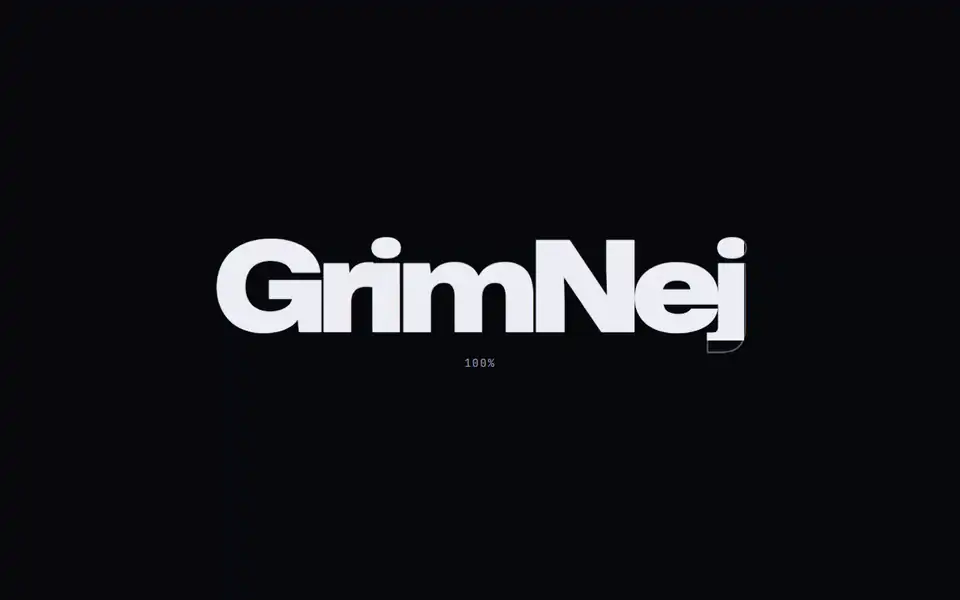
</div>

<table>
  <tr>
    <td width="50%">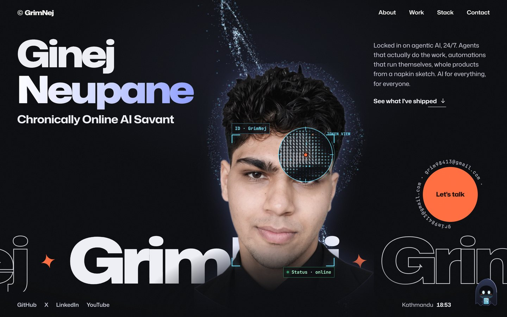</td>
    <td width="50%">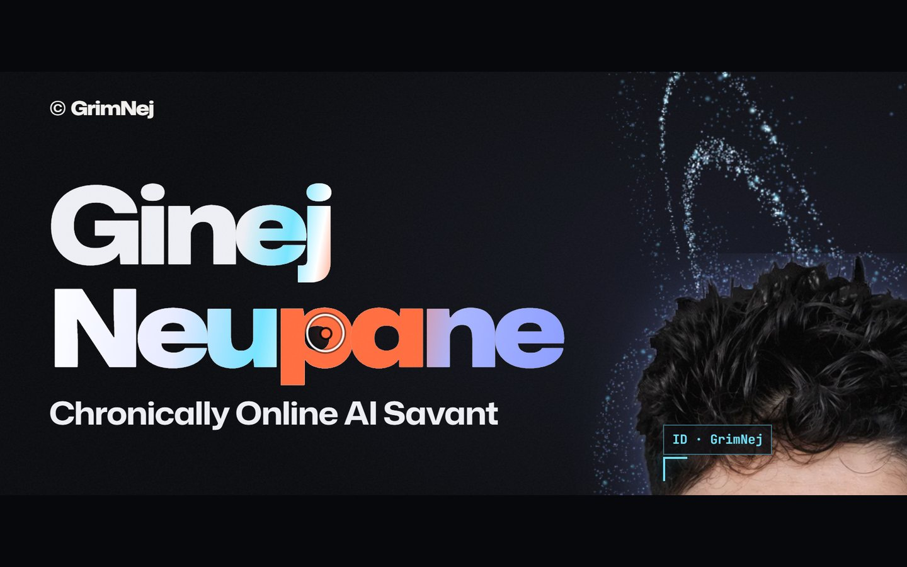</td>
  </tr>
  <tr>
    <td><b>Token view.</b> Hover the portrait and a lens reads you the way a model reads pixels: as characters. It only opens over the person, never the empty corners.</td>
    <td><b>A name that notices you.</b> Letters swell as the cursor passes, one runs hot in the accent colour, a streak of light crosses on load, and a fast flick splits the colour channels.</td>
  </tr>
  <tr>
    <td>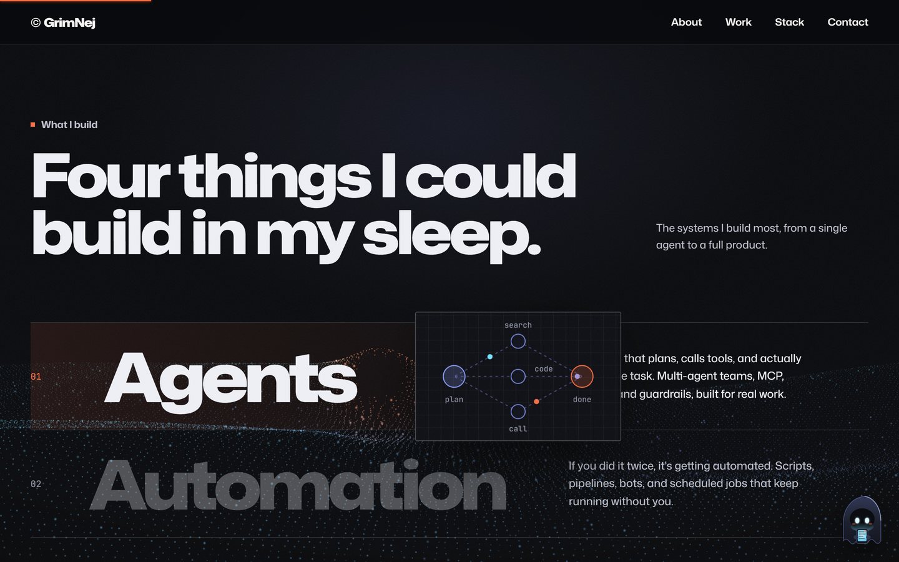</td>
    <td>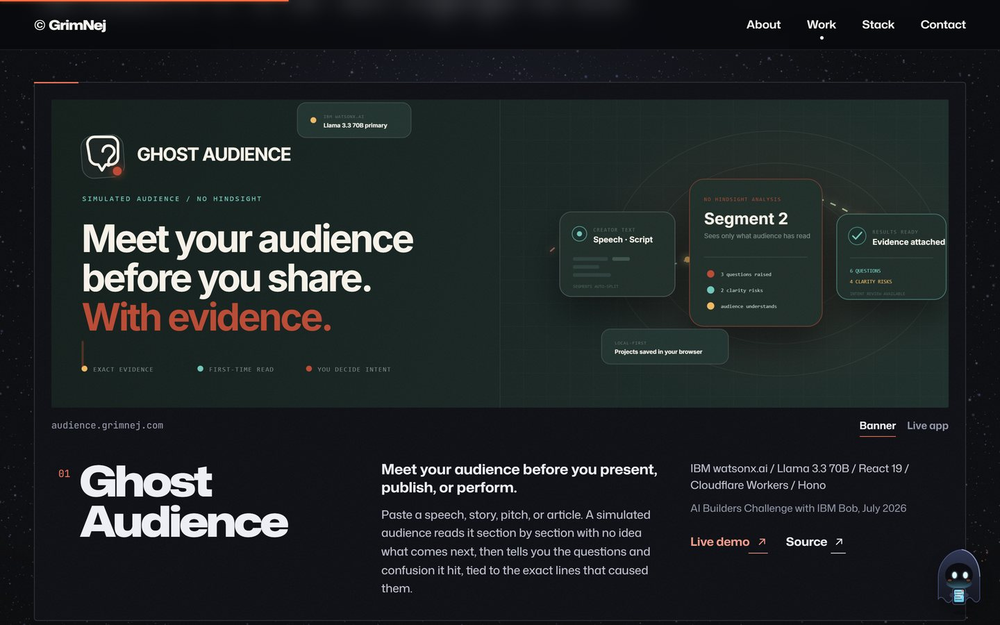</td>
  </tr>
  <tr>
    <td><b>What I build.</b> Four huge words. Hover one and a live diagram follows your cursor: agents fanning out to tools, a pipeline running, a chart drawing itself. Seven to choose from.</td>
    <td><b>Stacked work.</b> Project cards pile up as you scroll, each with its real banner or live app in a browser frame, view toggles, stack and links.</td>
  </tr>
  <tr>
    <td>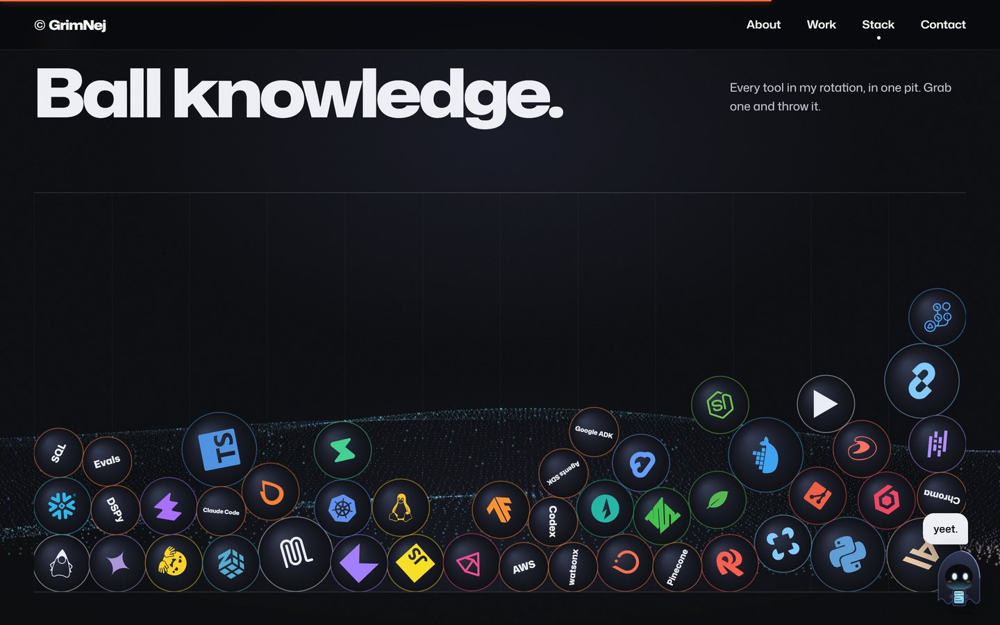</td>
    <td>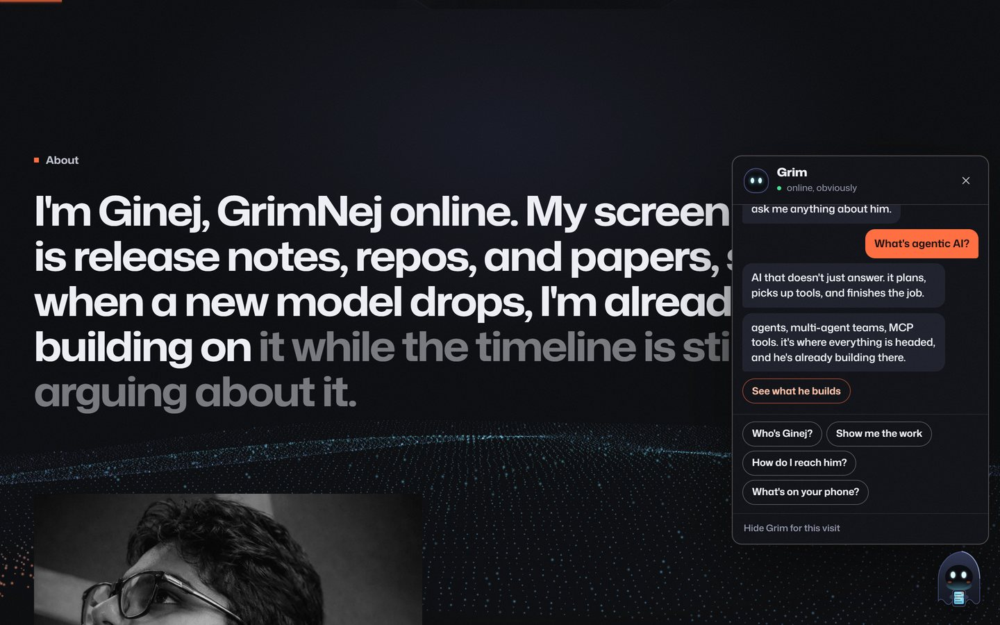</td>
  </tr>
  <tr>
    <td><b>Ball knowledge.</b> Your stack as a physics pit. Grab a logo, throw it, watch it bounce off the others.</td>
    <td><b>A ghost with opinions.</b> The mascot comments on each section, falls asleep if you idle, reacts to your throws, and answers questions with buttons that jump, copy or link.</td>
  </tr>
  <tr>
    <td>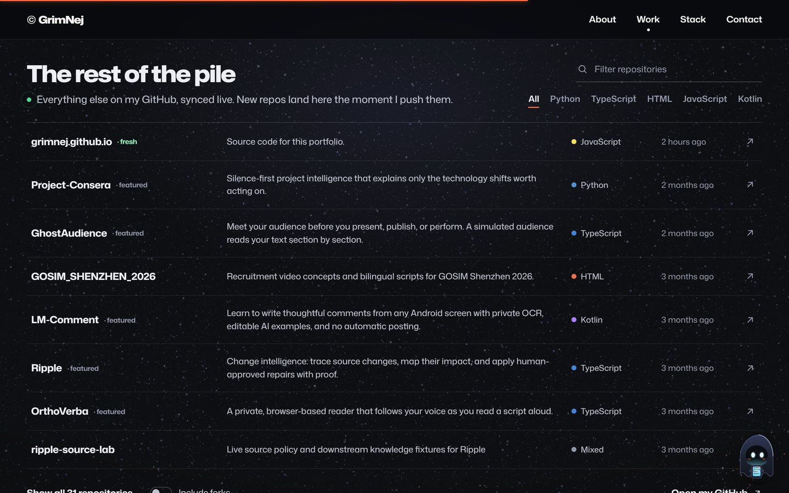</td>
    <td>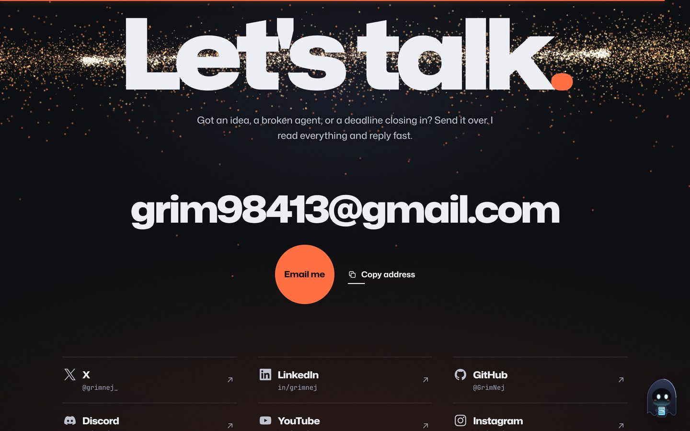</td>
  </tr>
  <tr>
    <td><b>The rest of the pile.</b> Every public repo, synced live from GitHub with filters, search and forks on demand. Private repos can't leak: it only ever reads the public API.</td>
    <td><b>Let's talk.</b> The galaxy comes back for the finale. Email in big type, one-tap copy, every profile you have.</td>
  </tr>
</table>

<div align="center">
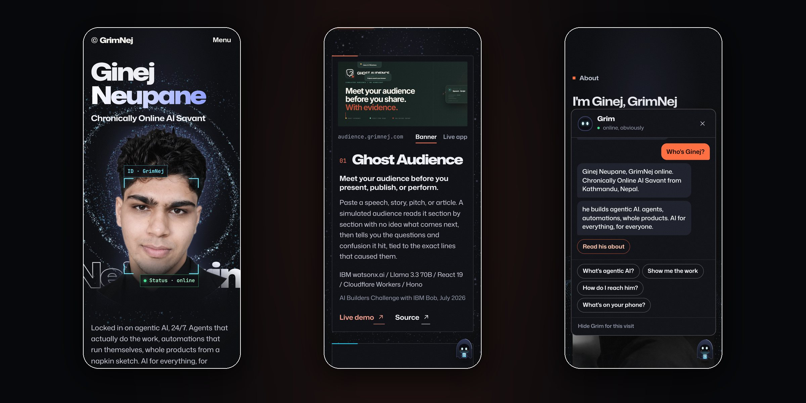
</div>

**Also in the box:** a preloader that waits for everything (fonts, portrait, first frame) so nothing pops in half-built, a custom cursor that labels what you're about to click, a header that gets out of the way, an About statement that lights up word by word, crossing tape bands, a process line that fills as you scroll, an outlined footer wordmark that fills on hover, a themed favicon, a generated share card, JSON-LD, sitemap, and a proper 404.

## How it works

<div align="center">
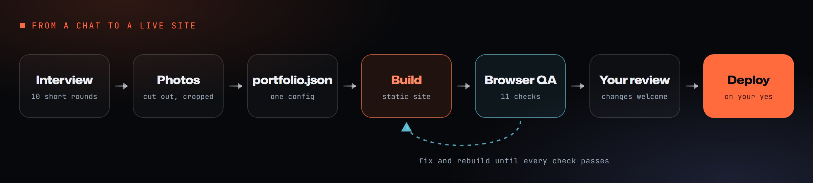
</div>

1. **Interview.** Claude asks about you in ten short rounds: identity, photos, links, what you do, the four kinds of work you build, your projects, your stack, your process, a colour theme and the mascot. Choices come as buttons; anything you'd rather not write, it drafts for you in your voice and shows you first.
2. **Your GitHub, mined.** It scans your public repos, reads the READMEs, finds banners, taglines and live links, and proposes what to feature.
3. **Photos.** Your portrait gets cut out with BiRefNet (holes in dark clothing filled, cropped to the figure) and the About photo squared and toned.
4. **Build.** One JSON file becomes the whole site: themed CSS, your icon sprite, generated favicon, share card, SEO, sitemap. No framework, no bundler, no dependencies.
5. **QA.** A real browser goes through the page: no JavaScript errors, nothing overflowing at 23 screen sizes, no two pieces of text overlapping at any scroll position, hover states that clear, the chat answering every question, accessibility with axe-core, and more.
6. **Ship it.** Only when you say so: GitHub Pages with your domain, with the Cloudflare settings that matter.

## Install

**As a plugin** (in Claude Code):

```
/plugin marketplace add GrimNej/Portfolio-Design-Skill
/plugin install portfolio-design@grimnej
```

**Or copy the skill** into your personal skills folder:

```bash
git clone https://github.com/GrimNej/Portfolio-Design-Skill
cp -r Portfolio-Design-Skill/skills/portfolio-design ~/.claude/skills/
```

Then ask Claude Code: *"Build me a portfolio site."*

**Requirements:** Node 18+, Python 3.10+, `pip install playwright pillow numpy` and `playwright install chromium`. For the portrait cut-out, `pip install "rembg[cpu]"` (or bring a transparent PNG). Claude checks all of this before starting.

**Try it without the interview:** the repo includes a complete config for a fictional person.

```bash
cd skills/portfolio-design
node scripts/build.mjs --config examples/portfolio.example.json --out /tmp/rowan
python scripts/render_images.py --site /tmp/rowan
python scripts/serve.py --site /tmp/rowan --port 4321
```

## Make it yours

<div align="center">
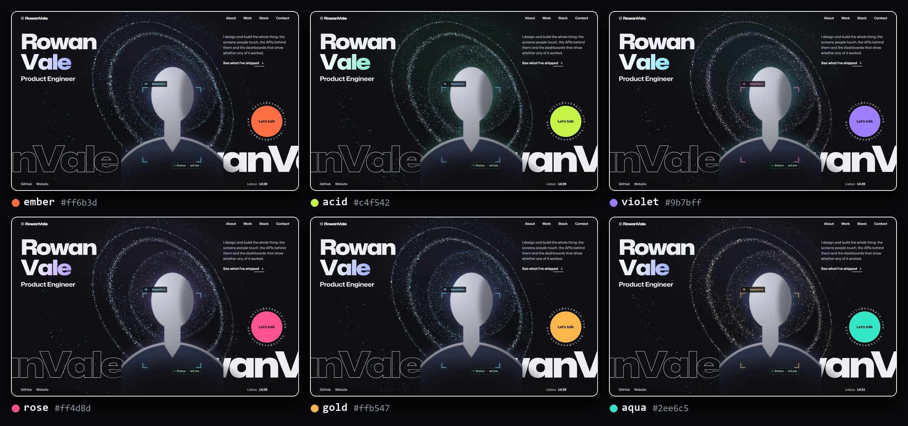
</div>

| You choose | Options |
|---|---|
| Colour | `ember`, `acid`, `violet`, `rose`, `gold`, `aqua`, or any accent / signal / ice hex values |
| What you build | four rows from `agents`, `automation`, `context`, `launch`, `code`, `data`, `design` |
| Projects | 1 to 6 featured, up to 3 side quests, 1 to 3 images each |
| Mascot | keep the ghost, rename it, rewrite its lines in your voice, or switch it off |
| Archive | live GitHub repos with a hide list, or off |
| Links | 27 networks with icons and brand colours, any of them in the hero |
| Stack | 12 to 24 balls from 200+ bundled logos (more fetched on demand) |

Long names, long handles and long headings scale to fit instead of breaking the layout. Every field is documented in [`config-schema.md`](skills/portfolio-design/reference/config-schema.md).

## Quality gates

`scripts/qa/run_all.py` is the bar every build has to clear before you see it:

| Check | Proves |
|---|---|
| `smoke` | Loads clean on desktop and phone; curtain lifts; galaxy, name, portrait, header behaviour all work |
| `overflow` | Nothing sticks out sideways at 23 screen sizes; display words never cut off |
| `overlap` | No two pieces of text overlap anywhere, at any scroll position, even mid-hover |
| `hover` | Previews, cursor labels and the lens clear when the page scrolls under a still mouse |
| `chat` | Every mascot question answered, actions work, Escape closes, fits on a phone |
| `name` | Gradient letters are drawn in full, right edge included |
| `cursor` | The cursor dot never lags the pointer |
| `preload` | A slow portrait holds the curtain instead of showing a half-built hero |
| `a11y` | No serious or critical axe-core issues |
| `live` | After deploy: no Cloudflare email rewriting, real 404s, robots, sitemap, share image |
| `shots` | Every screen captured at desktop and phone size for a final look |

Each check exists because that exact thing went wrong once while this design was built.

## Built with

| Layer | Tools |
|---|---|
| **Motion** | [GSAP](https://gsap.com) 3.15 with ScrollTrigger and SplitText, [Lenis](https://github.com/darkroomengineering/lenis) smooth scroll |
| **Graphics** | Hand-written WebGL2 shaders for the particle galaxy, Canvas 2D for the ASCII lens and the physics pit, inline SVG for the diagrams and the mascot |
| **Type** | [Mona Sans](https://github.com/github/mona-sans) variable (weight and width axes), [JetBrains Mono](https://www.jetbrains.com/lp/mono/) |
| **Icons** | [Simple Icons](https://simpleicons.org), compiled into one SVG sprite per site |
| **Code** | Vanilla ES modules and one hand-tuned stylesheet. No framework, no bundler |
| **Build** | Node 18+, zero dependencies |
| **Photos** | [rembg](https://github.com/danielgatis/rembg) with BiRefNet portrait matting, Pillow |
| **Testing** | [Playwright](https://playwright.dev), [axe-core](https://github.com/dequelabs/axe-core) |
| **Data** | GitHub REST API (public endpoints only) |
| **Hosting** | GitHub Pages, Cloudflare-ready |

## Inside the repo

```
.claude-plugin/              plugin + marketplace manifests
skills/portfolio-design/
  SKILL.md                   the workflow Claude follows
  reference/                 interview script, config schema, design system,
                             copy rules, quality gates, deploy guide
  template/assets/           the site: CSS, JS modules, fonts, vendor libraries
  scripts/
    build.mjs                portfolio.json -> complete static site
    prepare_photos.py        portrait cut-out and About photo
    discover_github.mjs      finds your best public repos and their banners
    snapshot_github.mjs      offline fallback for the live archive
    render_images.py         share card and touch icon
    serve.py                 local preview server
    qa/run_all.py            the quality gates
  data/simple-icons.json     200+ logos for the pit
  examples/                  a full config for a fictional person
docs/                        the images in this README
```

## Privacy

Only public GitHub data is ever read, and through the unauthenticated API on purpose, so private repositories can't end up on a page no matter what credentials are around. Claude shows you the repo list before the archive goes live, never publishes or pushes without your explicit yes, and keeps your original photos local.

## License

MIT for the skill, scripts and templates. Bundled third-party files keep their own licenses: see [THIRD-PARTY-NOTICES.md](THIRD-PARTY-NOTICES.md).

<div align="center">
<sub>Designed and built by <a href="https://grimnej.com">Ginej Neupane (GrimNej)</a> with Claude Code.</sub>
</div>
